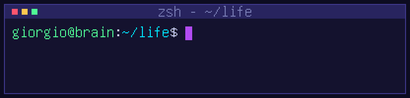

## Hi 👋🏻, I'm Giorgio
Software Engineer focused on mobile and cross-platform development, with a particular interest in Android. I’m aiming to grow into a full-stack role, working on both the mobile app and the backend.
I also have a good foundation in C and systems programming, which also represent another field which I'm strongly interested in.

- 🌱 Final year Computer Science student at the **University of Pisa**

 

### 📂 Public projects

| Repository | Description | Tech stack |
| --- | --- | --- |
| [Runly](https://github.com/giorgio-micheli/runly) | Offline-first Android running tracker with live GPS tracking |   |
| [PillsOClock](https://github.com/giorgio-micheli/pillsoclock) | Android app for medication reminders |   |

<h3 align="left">Connect with me:</h3>

